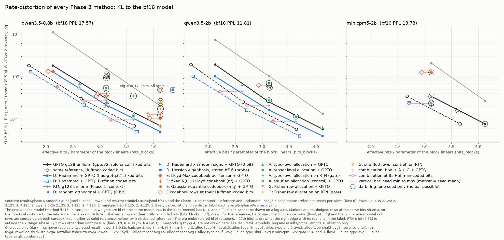
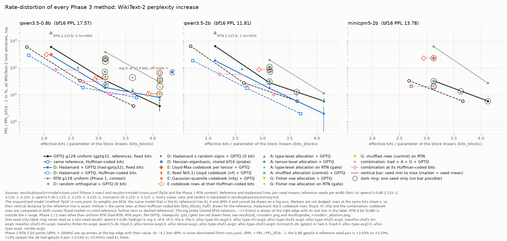

# wcomp 报告：用有损压缩探测 LLM 权重结构

2026-11-08。三个阶段（Phase 1 基线、Phase 2 结构探针、Phase 3 方法）的总结。协议见 [DESIGN.md](DESIGN.md)，
每个数、每个判决、每次审计和更正见实验记录 [NOTES.md](NOTES.md)。本文所有数字都读自或重算自
`results/` 下的结果文件（重算脚本见第 9 节）。方法字母沿用任务书：**A** 敏感度驱动的比特分配，**B** 低秩 + 量化残差，
**C** 层间差分编码，**D** 最小化输出 KL 的旋转，**E** 非均匀码本 + 熵编码索引（对照 6.02 dB/bit 界），
**F** 按使用频率量化，**G** 自己的想法。

## 1. 一句话结论 / TL;DR

**没有找到可归为"真正新"的权重结构或方法。** 稳健的增益只来自两件文献里早已有的事：

- **零比特旋转 + GPTQ（D，即 QuIP/QuaRot 式的 incoherence processing）**：3 bit 时 KL 比均匀 GPTQ 低 29–36%
  （0.8B −29.9% / −28.9%，2B −35.8% / −35.3%，MiniCPM −29.9%（1 seed）），折合 +0.23–0.30 bits/param（定长码）。
- **索引熵编码（E）**：Huffman 在 2–4 bit 白省 0.44–0.49 bits/param，离 order-0 熵 0.012–0.018 bit（4 bit 时 0.015–0.016）。

一个**不稳健**的正结果：**A 的张量级分配**在 0.8B avg 3 两个 seed 都过预注册规则（KL −18.7% / −20.1%，dPPL 也过，
+0.141 / +0.153 bit），但分配信号只测了一次（两个 seed 用同一份损伤文件），2B 上不胜（Fisher 信号，1 seed），
也从未在 Hadamard 之上测试。

其余失败或落在噪声内：A 的类型级分配（从 RTN 损伤推出）在 GPTQ 上等于或劣于均匀分配；E 的 Lloyd-Max 码本在 3–4 bit
KL 高 13–267%，2 bit 定长按规则胜（KL ×0.72–0.74），但索引近乎等概，Huffman 后反亏 0.19–0.20 bit；G 的 Fisher 行分配
在 RTN 上 −14.7%，换成 GPTQ 后不过规则；组合方案在 avg 3 只省 0.48–0.55 bits/param（Qwen，含编码），预注册的是 1.0–1.3，
而且在 avg 3 比单用 Hadamard 差 25–31%，在段中点宽度上与 Hadamard 分辨不出差别。B、C、F 在 Phase 2 探针后放弃；
D 只做了零比特旋转（学习旋转需要训练，被规则禁止）。

**压缩揭示的结构：** 权重 ≈ 按 group 缩放的高斯 + 重尾。超出"高斯 + group scale"的可编码结构全模型只有
0.04–0.07 bit/param（P1）；低秩、层间差分、离群列扣掉 side info 后净增益全为负（全模型分别 −0.14 到 −0.19、约 −0.43、
−0.03 到 −0.05 bit/param）；旋转的增益与结构无关（随机正交和 Hadamard 一样好）。Qwen3.5 没有 super weight，这与其
attention 输出门控的已知效应一致（5.1 K6），不算新发现。本项目有用的产出是一串带对照的负结果和几条方法学教训（第 6、7 节）。

## 2. 设置与协议

| 项 | 内容 |
|---|---|
| 模型 | Qwen3.5-0.8B（主模型；任务书写的 0.6B 不存在）、Qwen3.5-2B（均为 Gated DeltaNet + 门控 softmax attention 混合，`attn_output_gate: true`）、MiniCPM5-2B（Llama 架构，作架构无关性检查） |
| 量化范围 | `model.layers.*` 内所有 `nn.Linear`（含 16×1024 的 `in_proj_a/b`），共 497.6M / 1372.7M / 1981.8M 参数；embedding / lm_head 保持 bf16 |
| PPL | WikiText-2 raw **test**，2048 token 不重叠窗口，全部窗口（Qwen 145 窗 / 296,815 token，MiniCPM 139 窗 / 284,533 token） |
| dPPL | **dPPL = PPL_q / PPL_bf16 − 1（%）**。"dPPL 比值" = 该行 dPPL / 基线曲线在同比特处的 dPPL，与单位无关。只有明确写"PPL 点"时才是绝对差 PPL_q − PPL_bf16 |
| KL | KL(P_bf16 ‖ P_q)，前 32 个窗口（65,504 token），f32；另报 top-1 一致率 |
| 参考模型 | 结果文件里叫 `fp16` 的行就是**未量化的 bf16 模型**（note 字段 "bf16, not quantized"），它同时是 PPL 和 KL 的参考；PPL 17.57 / 11.81 / 13.78 |
| 有效比特 | 两段码。`bits_blocks` = 量化 linear 的全部比特 / 参数数：索引 + f16 group scale（16/128）+ 码本 + 分配表（每单元 3 bit）+ 行宽表（2 bit/行）+ 存储的旋转矩阵（bf16 全额计）；确定性 Hadamard 和带种子的随机矩阵记 0 bit。`bits_blocks_huff`：每个 tensor 在单符号 Huffman（表 b·2^b bit）、符号对 Huffman（表 2b·2^2b bit）和定长码之间取最优，再加 2 bit 选择位；所有 side info 都计入。均匀 4 bit g128 = 4.125 |
| 校准 | C4 validation，128×2048 token，seed = run seed；分配用的损伤在另一份 seed-2 C4 集上测（32 窗，去掉了校准文档）。**Phase 3** 中 WikiText 只在最终 `evaluate` 中读取。**Phase 2** 的结构与消融测量用的是 WikiText-2 test：P0 的 `@only` 消融（`@only` = 只量化该类型、其余保持 bf16）、P3 的 keepcols 行、P7 的 keepsuper 行和置零检验（16 个 WikiText 窗口）。它们没有用来定比特，但影响了跑哪些方法（Phase 3 短名单、H3-A 的设计、放弃 B/C/F），这是评测集上的研究者自由度。Phase 3 的 C4 与 WikiText 类型损伤排序 Spearman 0.96–1.00，限制了这种影响 |
| 基线 | `gptq32-sym-g128-{4,3,2}`（GPTQ，f32 逐窗 Hessian 乘积），两个 seed（MiniCPM：4 bit 1 seed，3 bit 2 seed） |
| "beats" 规则（预注册） | 在每个存在的 seed 上，KL 比基线 seed 均值曲线（对 bits 做 log-linear 插值）低 5% 以上，**且** dPPL 低 4.4% 以上。"saved" = 曲线在该行 KL 处的比特 − 该行比特（定长对定长，Huffman 对基线自己的 Huffman 曲线） |
| 禁止事项 | 不训练、不蒸馏、不对权重做梯度步；允许 GPTQ 误差反馈、Lloyd-Max、在 C4 上测 Fisher（不回写） |

**噪声模型（实测，[NOTES.md](NOTES.md) "Reference curve and the noise model with all seed pairs"）。**
两个 seed 只重复了 GPTQ 校准噪声：

| 模型 | seed 对数 | KL 离散（中位 / 最大） | KL 离散 > 5% 的对 | ~4.1 bit 处 dPPL 离散 |
|---|---|---|---|---|
| 0.8B | 21 | 1.8% / 7.9%（gptq32-4） | 5 | 7–113% |
| 2B | 13 | 2.1% / 12.3%（had-4） | 1 | 3–713% |
| MiniCPM | 1 | 0.9% | 0 | n/a |

3.125 bit 处 KL 离散为 0.7–3.9%（Lloyd 5.1%），5% 的 KL 门槛够用；4.125 和 2.125 bit 处达 6–12%，KL 比值在
0.88–0.95 之间的差异用两个 seed 分辨不了。4 bit 的 dPPL 基本是噪声：0.8B 基线 gptq32-4 两个 seed 的 dPPL 是
+2.43% 和 +5.19%（即 0.43 和 0.91 个 PPL 点，相差 113%）。**没有采样**的噪声：分配信号（所有 seed 用同一份损伤文件，
seed 0/1 的分配 JSON 在 18 对里完全相同）和评测窗口（所有行共用同 32 个 KL 窗口，比较是配对的）。

## 3. RD 图





`results/report_rd.png`（y = KL，log）和 `results/report_rd_ppl.png`（y = dPPL %，log），x = `bits_blocks`，
每个模型一个面板，Phase 3 全部方法画在同一张图上。读法：

- 黑实线 = 均匀 GPTQ 基线（seed 均值），黑虚线空心 = 同一批行放在它们的 Huffman 比特处；蓝线 = Hadamard + GPTQ，
  实线/虚线同理。灰线 = Phase 1 均匀 RTN（背景）。竖线 = seed 最小到最大，标记 = seed 均值。
- **空心孪生点**：E 的码本行（lloyd、nf、nfq）和组合行除了定长比特处的实心点，还在 Huffman 比特处有一个空心点，
  用细线连起来；实心点要和黑实线比，空心点要和黑虚线比。例：0.8B 的 Lloyd 2 bit 在定长比特处明显低于实线
  （KL 1.34 对 1.83），但它的空心点在 2.04 bit，落在虚线（基线 2 bit 编码后 1.68 bit）的右上方，也就是"定长赢、编码后输"。
- **深色圆圈** = 只有一个 seed 的点（没有竖线不代表两个 seed 很接近）；图脚按模型列出了这些方法。MiniCPM 上
  所有 Phase 3 方法都只有 1 个 seed。
- eig 旋转探针的总 `bits_blocks` 是 17.89（3.125 的索引与 scale + 14.767 的存储旋转），画在右边缘并标注真实比特。
- **图的范围**：只画 Phase 3 方法和 Phase 1 均匀 RTN。第 5 节引用的 Phase 1/2 行（had-RTN、RTN asym、f64 GPTQ、
  keepcols、g32/g64）不在这张图上，见 `results/rd_<model>.png`（Phase 1 各族）和 `results/probe_<model>_ablation.png`
  （group size、+keepcols 与 GPTQ 的 bits 对 KL）。
- 等质量点（插值，不是实测行）：Hadamard 曲线在 3.905 bit（0.8B）/ 3.859 bit（2B）达到 gptq32-4 的 seed 均值 KL，
  比 4.125 少 0.22 / 0.27 bit；加上 Huffman 是 3.483 / 3.437 bit，比 gptq32-4 的定长码少 0.64 / 0.69 bit
  （其中约 0.42 是编码增益），比 gptq32-4 自己的 Huffman 码少 0.16 / 0.20 bit。

各方法逐行的数值、比值和判决见 [results/phase3/summary.md](results/phase3/summary.md)；单模型图
`results/rd3_<model>.png`。

## 4. 结构表（Phase 2 探针 vs 打乱对照）

每格是 `gain_bits（Δ = gain − 对照, 判决）`，单位 bits/param，已扣除探针自身的 side info；按 tensor 参数量加权到
weight type。`gain_bits` 是该结构真正能省的比特；`Δ` 是"结构"本身的值（打乱检验）。判决规则：|Δ| > 0.02 且大于两个
对照 seed 之差。P1 的对照是同 group std 的高斯（边缘分布对打乱不变），其余是打乱对照。完整表：
[results/structure_table.md](results/structure_table.md)。

**qwen3.5-0.8b**（P = pass，F = fail；¹ = 只有一个对照 seed，只用了 0.02 bit 门槛，"大于两个对照 seed 之差"那半条无法检查）

| type | 参数占比 | P1 熵编码（4 bit）¹ | P2 低秩 | P2b 激活加权低秩 | P3 离群列 | P4 层间（置换对齐）¹ |
|---|---|---|---|---|---|---|
| in_proj_qkv | 22.8% | +0.488 (+0.049 P¹) | −0.101 (+0.068 P) | −0.057 (+0.091 P) | −0.048 (+0.005 F) | −0.494 (−0.000 F¹) |
| in_proj_z | 7.6% | +0.481 (+0.043 P¹) | −0.126 (+0.089 P) | −0.029 (+0.166 P) | −0.041 (+0.012 F) | −0.494 (+0.006 F¹) |
| in_proj_ab | 0.1% | +0.510 (+0.076 P¹) | −0.657 (+0.299 P) | −0.591 (+0.359 P) | +0.005 (+0.058 P) | −0.109 (+0.400 P¹) |
| out_proj | 7.6% | +0.556 (+0.118 P¹) | −0.177 (+0.038 P) | −0.198 (−0.006 F) | −0.042 (+0.005 F) | −0.501 (+0.000 F¹) |
| gate | 17.7% | +0.480 (+0.040 P¹) | −0.141 (+0.044 P) | −0.080 (+0.087 P) | −0.049 (+0.004 F) | −0.335 (+0.080 P¹) |
| up | 17.7% | +0.486 (+0.047 P¹) | −0.170 (+0.015 F) | −0.166 (+0.006 F) | −0.052 (+0.002 F) | −0.394 (+0.026 P¹) |
| down | 17.7% | +0.509 (+0.070 P¹) | −0.169 (+0.015 F) | −0.152 (+0.030 P) | −0.048 (+0.001 F) | −0.376 (+0.051 P¹) |
| q | 5.1% | +0.509 (+0.069 P¹) | −0.031 (+0.148 P) | +0.067 (+0.228 P) | −0.034 (+0.019 F) | −0.502 (+0.031 P¹) |
| k | 0.6% | +0.540 (+0.100 P¹) | −0.168 (+0.046 P) | −0.156 (+0.055 P) | −0.033 (+0.018 F) | −0.534 (−0.001 F¹) |
| v | 0.6% | +0.605 (+0.165 P¹) | −0.181 (+0.033 P) | −0.179 (+0.030 P) | −0.044 (+0.004 F) | −0.453 (+0.001 F¹) |
| o | 2.5% | +0.601 (+0.163 P¹) | −0.175 (+0.039 P) | −0.216 (−0.013 F) | −0.032 (+0.020 P) | −0.489 (−0.000 F¹) |

**全模型（按参数量加权）：gain / 对照 / Δ**

| 模型 | P1 熵编码¹ | P2 低秩 | P2b 加权低秩 | P3 离群列 | P4 层间¹ |
|---|---|---|---|---|---|
| 0.8B | +0.500 / +0.439 / +0.061 | −0.140 / −0.188 / +0.048 | −0.106 / −0.172 / +0.067 | −0.047 / −0.052 / +0.005 | −0.428 / −0.458 / +0.030 |
| 2B | +0.508 / +0.439 / +0.069 | −0.167 / −0.204 / +0.038 | −0.136 / −0.200 / +0.063 | −0.046 / −0.052 / +0.006 | −0.426 / −0.458 / +0.032 |
| MiniCPM | +0.479 / +0.439 / +0.040 | −0.190 / −0.208 / +0.018 | 未测 | −0.034 / −0.051 / +0.017 | −0.430 / −0.453 / +0.023 |

读法：很多格"通过"打乱检验（权重不是白噪声），但只有 P1 的 gain 是正的，而且 0.44 来自高斯 + group scale
（对照本身），超出高斯的部分全模型只有 0.04–0.07 bit。"通过且 gain ≤ 0" 只说明不是白噪声，不是杠杆。
in_proj_ab 每个探针都通过，但只占 0.12% / 0.09% 的参数和约 1% 的联合 KL。2B 上 Δ > 0.2 的格（全部列出）：
P1 v +0.322、in_proj_ab +0.337、k +0.238；P2 in_proj_ab +0.238；P2b in_proj_ab +0.279、in_proj_z +0.233；
P3 in_proj_ab +0.231；P4 in_proj_ab +0.384。

不进上表的探针：P5（使用频率，F 的依据）down_proj 输入 Gini 0.436 / 0.427 / 0.460（预注册 > 0.5），前 20% 通道占能量
0.52–0.54（预注册 > 0.6），split-half Spearman 低于 0.9 的层 7/24、13/24、16/42；o / out_proj 输入在 Qwen 上
Gini 0.69–0.76 且稳定。P6a（GPTQ 目标的 H_jj 敏感度）与实测损伤的 Spearman −0.33 / −0.05 / +0.25；P6b Fisher
rank-1 拟合 0.90–0.99（K-FAC 形式本来就会这样）。P7 super weight 见 5.1 K6。

## 5. 结果分三类

判定从严：文献里有的（incoherence processing、混合精度分配、索引熵编码、super weight / massive activation、离群通道），
即使对我们是新的，也归"复现已知"。"违背我们的预注册先验"只说明先验校准得不好，不构成新发现。

### 5.1 复现已知

| # | 结果（数字、seed、模型） | 对应文献 / 说明 |
|---|---|---|
| K1 | **D：Hadamard + GPTQ。** 3 bit KL 比值（相对基线曲线）0.701 / 0.711（0.8B）、0.642 / 0.647（2B）、0.701（MiniCPM，1 seed），dPPL 也过，定长省 +0.23 到 +0.30 bit，Huffman 后 +0.17 到 +0.23。随机正交 / Hadamard KL 1.006 / 0.955，带随机符号的 Hadamard / Hadamard 1.004（1 seed）。4 bit：0.8B −24.5% / −29.7% KL，但 dPPL 比值 2.306 / 1.820，按规则判"不胜"，**只能算 KL 结论**；2B −35.2% / −27.3%，判胜，但省比特数在曲线外外推。2 bit：增益因模型而异，0.8B −29.6% / −29.2%，2B −47.2% / −47.7%（各 2 seed；只有两个模型，原因未查） | QuIP / QuIP#、QuaRot、SpinQuant。增益来自通用的不相干化，与模型结构无关（随机正交一样好）。我们预注册 4 bit 增益 < 10%，结果错了，属于先验校准问题 |
| K2 | **E：索引 Huffman。** 基线定长 − Huffman：0.8B 0.483 / 0.468 / 0.444（4/3/2 bit），2B 0.491 / 0.476 / 0.451，MiniCPM 4 bit 0.464（1 seed）、3 bit 0.449；离 order-0 熵 0.012–0.018 bit（4 bit 时 0.015–0.016）。旋转会吃掉一部分编码增益：3 bit 0.411 对 0.468（−0.057 bit），这是预料之中的（旋转让分布更接近高斯） | 量化后熵编码（Deep Compression 一类）。P1 已从熵预测出 0.48–0.51（其中 0.44 是高斯部分）。预注册的 3 bit 0.25–0.40、2 bit < 0.20 偏低：先验问题，不是改进 |
| K3 | **A 在 RTN 上有效。** 0.8B 类型级分配在 RTN 上 KL 是均匀 RTN 曲线的 0.628 / 0.633 倍（avg 3 / 3.5，1 seed）。另：GPTQ 上的两个打乱分配比均匀差 1.76 / 3.75 倍（0.8B）、2.24 / 2.80 倍（2B），各 1 seed。这说明分配不是任意的，但真实分配在 GPTQ 上也不优于均匀（第 6 节），所以打乱对照不支持"A 有效" | 混合精度分配（HAWQ 等） |
| K4 | **敏感度代理：H_jj 不行，Fisher 行。** GPTQ 的层内 Hessian 对角 H_jj 与各类型实测损伤 Spearman −0.33 / −0.05 / +0.25（逐层 −0.28 / −0.51），因为它跟随 linear 输入的 RMS（隐状态输入 1.0–1.4，down/o/out_proj 0.09–0.23），看不到输出误差如何传到 loss。Fisher 对角 +0.96（0.8B，11 个类型，**事后分析、未预注册、只查了一次**） | H = XX^T 是层内重建目标，跨层不可比；跨层分配要用 loss 层面的曲率（HAWQ 的 Hessian trace、SqueezeLLM 的 Fisher 对角）。只是违背了我们预注册的 > 0.7 |
| K5 | **按权重列范数保护 1% 列（keepcols）基本无效。** 恢复 RTN-4 KL 的 3.2% / 7.8% / 17.0%，代价 +0.118 bit，劣于把这些比特给索引。除 in_proj_ab / k（Qwen）和 k / q（MiniCPM）外，没有范数 > 5 倍中位数的列 | AWQ Table 1（OPT-6.7B INT3-g128）：按激活选 1% 为 11.39，按权重选 22.37，随机 24.23，RTN 23.54，即按权重选 ≈ 随机。LLM.int8 的离群是**激活**特征，不是权重列范数，我们没有测按激活选列 |
| K6 | **super weight：MiniCPM5 有，Qwen3.5 没有。** MiniCPM5（Llama 架构，无输出门控）：`layers.7.mlp.down_proj[106,1460]` = 1.055，置零 dPPL +205.6%（量级对照 +0.08%）；layer 7 down_proj 输出最大 4640（中位数的 273 倍）、输入最大 4320（165 倍）；g128 RTN-4 下保护它只值 0.3% 的 KL（0.26742 对 0.26816）。Qwen3.5-0.8B / 2B（`attn_output_gate: true`）：按 Yu et al. 的方法（down_proj 输入输出同时出现尖峰，20 倍中位数门槛）找不到候选；0.8B 最强输出尖峰只有中位数的 11.8 倍，置零 17 个候选 dPPL −0.19% 到 +0.04%；2B 的 massive-activation 通道 1201 输出最大 33.5（中位数的 20.6 倍，绝对值约为 MiniCPM 的 1/139），没有输入尖峰，最大置零 dPPL +0.61%（量级对照也到 0.61%） | Yu et al. 2024（super weight 产生 massive activation；对粗粒度 RTN 才关键，小 group 已能表示它）；Sun et al. 2024（massive activations）；Qiu et al. 2025（Gated Attention，NeurIPS 2025：SDPA 输出的 sigmoid 门控抑制 massive activation 和 attention sink，并用于 Qwen3-Next）。Qwen3.5 缺 super weight、massive activation 弱一个量级，正是这些文献的预期。**限制**：两个 Qwen 模型、一种检测方法（1 个 C4 窗口定尖峰、top-16 \|w\|、16 个 WikiText 窗口做置零）。我们没有做区分实验，归因于 Gated DeltaNet 层**未经检验**（DeltaNet 层也有输出门 `in_proj_z`）。它不是压缩杠杆 |
| K7 | **eig 旋转（标价的数据相关旋转，1 seed）。** 旋转存储 14.767 bits/param，总 `bits_blocks` ≈ 17.9，saved −15.04；而且计比特之前 KL 就是 0.48990，是 gptq32-3（seed 0，0.29988）的 1.63 倍 | 存储代价是预期的。质量下降可由已知理论解释（**假设，未检验**）：在校准 Hessian 的特征基下 H 近似对角，GPTQ/LDLQ 的误差反馈依赖非对角项，H 对角时退化为最近舍入（QuIP），同时能量集中，与不相干化相反。KL 落在 GPTQ-3（0.300）和 RTN-3（原基，1.505）之间，与此一致但不是检验；检验需要一行未跑的 eig-RTN |
| K8 | 其他：权重重尾（峰度 > 1 的 tensor 151/187、135/187、192/296，Student-t 最优）；group size 不是杠杆（g32 比 g128 KL 好 1.39 倍，代价 +0.375 bit，落在 RTN 曲线上）；C4 与 WikiText 的类型损伤排序 Spearman 0.96–1.00；Fisher 行×列可分（K-FAC 形式）；GPTQ 远好于 RTN | 均为已知或可预期 |

**描述性观察（不是压缩增益，归在这里只为完整）。** Phase 2 的 4 bit RTN 损伤分散在各类型：写输出的类型 out_proj / down / up
（MiniCPM 是 down / up / o）合占联合 KL 的 53% / 55% / 61%；预注册的候选 in_proj_ab 和 v 只占 0.9% / 5.0%（0.8B）、
1.3% / 6.3%（2B）。`@only` 损伤在 4 bit 近似可加（0.95 / 1.04 / 0.97），3 bit 超可加（0.51）；首层和末层的 3 bit 损伤最大
（这一点在混合精度文献里常见，许多方案把首末层留在高精度）。全部是 RTN、单 seed。

### 5.2 小改进（实测，带条件）

| # | 结果 | 条件 / 注意 |
|---|---|---|
| S1 | **A 张量级分配（0.8B，损伤信号）**：`alloc-tensor-gptq32-avg3` KL 是曲线的 0.813 / 0.799，dPPL 0.861 / 0.857，+0.141 / +0.153 bit（定长），位于实测曲线点（3.125 bit）上，两个 seed 都过。这是 A 唯一的正结果。avg 3.5 的两行 KL 也低（0.804 / 0.840），但 dPPL 0.963 / 1.383，按规则判否，而且位于段中点（见 7.2），只能算 KL 方向一致 | 单模型、**单次损伤测量**（分配信号噪声未采样）。2B（Fisher 总量信号，1 seed）不胜：avg 3 为 1.089，avg 3.5 为 0.952 且 dPPL 1.016。**张量级分配从未在 Hadamard 之上测试**：组合方案用的是类型级分配（`combo.json` = had + rowalloc），所以"叠加旋转后是否还有用"没有答案。方法本身属于已知的混合精度 |
| S2 | **G 按 Fisher 行能量分行宽（自己的想法）**：RTN 门槛 KL 0.17509 对均匀 0.20514（−14.7%，预注册 10–20%），两个打乱行对照比均匀还差 1.30 / 1.18 倍（门槛三行均 1 seed）。换成 GPTQ 后 −7.5% 到 −9.2% KL（+0.05 到 +0.07 bit）：avg 4 两个 seed 和 avg 3 seed 0 由 dPPL 判否（dPPL 比值 2.272 / 2.873 / 1.087）；avg 3 seed 1 两个门槛都过（KL 0.908，dPPL 0.935），但只有 1/2 个 seed，判否 | **GPTQ 上的增益未成立。** 我们没有做足够的文献检索，无法排除按行/通道显著性做混合精度的先例，所以不算新 |

### 5.3 真正新的

**没有可归为真正新的结果。** NOTES 里唯一的候选（"Qwen3.5 没有 super weight"）已归入 K6：它可以由 SDPA 输出门控
抑制 massive activation（Qiu et al. 2025）加上 super weight 与 massive activation 的联系（Yu et al. 2024）解释。

NOTES.md 分类表里列为 "New / unexpected" 的几项，按本节标准重新归类：Phase 2 的离群列 → K5，H_jj vs Fisher → K4，
super weight 的缺失、保护价值和 massive activation → K6，"每参数损伤 ∝ 1/n_t" → 撤回（第 6 节），down_proj 使用频率和
bf16 无损界 → 负结果；Phase 3 的 4 bit Hadamard → K1，eig → K7，Lloyd-Max → 负结果，类型分配迁移失败 → 负结果，
组合 → 负结果，RD gap → 负结果 / 方法学，dPPL 门槛 → 方法学。

## 6. 负结果

**Phase 2（放弃 B、C、F 的依据）**

- **B 低秩 + 残差**：存 bf16 U、V 之后，每个模型的每个 block 类型 gain 都是负的（全模型 −0.140 / −0.167 / −0.190）；
  加权版只有 0.8B 的 q 为正（+0.067，全模型 < 0.004 bit）；加权秩坍缩是激活 Hessian 的性质（打乱对照同样坍缩）。
  embedding 有一点真实低秩增益（公式 +0.04，实测 MSE +0.087），但本项目没有量化 embedding。**B 放弃。**
- **C 层间差分**：唯一便宜的对齐（置换 P）后，残差能量 e = ‖W_l − P·W_{l−1}‖² / ‖W_l‖² > 1（gate 1.58 / 1.65 / 1.74，
  比直接预测为零还差）；每类型最佳 gain 除 in_proj_ab（−0.109 / −0.126，占 0.1% 参数）外为 −0.34 到 −0.53 bit，
  全模型 −0.428 / −0.426 / −0.430；输出侧 Procrustes 对对照同样拟合得好（N×N 自由参数）。**C 放弃。**
- **F 按使用频率**：down_proj 的使用不均匀程度不够（数字见第 4 节）且一半左右的层样本间不稳定；没有死通道（激活率 < 1%
  的通道占比 0 到 4e-4）；super weight 保护只值 0.3%。**F 放弃。**
- **"每参数损伤 ∝ 1/n_t"（NOTES Phase 2 新发现第 3 项）撤回**：这是共享分母造成的假相关。d = KL/n 与 1/n 的 Spearman
  0.802 / 0.908 / 0.850，而把 KL 在类型间随机置换（5000 次，rng seed 1）的零分布中位数是 0.820 / 0.876 / 0.945，
  p(零 ≥ 观测) = 0.58 / 0.31 / 0.85（WikiText；C4 损伤行 0.62 / 0.32 / 0.77，结论相同），没有通过打乱检验。实际上类型 KL
  随参数量**上升**（Spearman +0.64 / +0.80 / +0.60，log-log 斜率 0.44 / 0.40 / 0.29）。剩下的只是描述性事实：KL 对 n
  是次线性的。预注册的机制检验（d_t 对 ‖W_t X‖²/n_t）没有跑。重算：`scripts/report_numbers.py` 第 (7) 节；NOTES 已加
  2026-11-08 更正条目。
- H_jj 代理推出的 1.10 / 0.99 / 0.69 bit 分配收益：建立在被实测推翻的排序上，作废。H-P0 集中性（前三类型 > 60%）：
  53% / 55%（Qwen，否）；MiniCPM 61%（刚过）。bf16 无损编码界约 5.4 bit，高斯对照也是这么多，没有超出边缘分布的结构。

**Phase 3**

- **A 类型级分配迁移到 GPTQ 失败**（RTN-4 损伤 + 2^(−2b) 速率模型，两个 seed 只重复 GPTQ 校准噪声，损伤只测一次）：
  KL 相对曲线 avg 3 为 +5.7% / +4.3%（0.8B）、+19.7% / +15.6%（2B）；avg 4 为 +4.2% / +4.6%、+10.9% / +11.1%；
  avg 3.5 为 −7.0% / −8.6%（0.8B，只过 KL，dPPL 判否，且位于曲线段中点，落在弦偏差之内；弦偏差见 7.2：对凸曲线做
  log-linear 插值会高估段中点 KL 4–7%）、+0.2% / −1.0%（2B）；MiniCPM avg 3.5 −1.3%（1 seed），avg 3 的最优分配就是
  均匀。avg 2.5 的规则"胜"（0.932 / 0.934、0.925 / 0.918）在二次曲线下是 0.971 / 0.974、0.991 / 0.984，**不成立**。
  可能的原因（提出未检验）：速率模型假设每少 1 bit KL ×4，实测 GPTQ 曲线 4→3 bit 是 ×4.35 / ×4.36，3→2 bit 是
  ×6.07 / ×7.59，而 avg 3 恰好把最大的类型压到 2 bit。用部署时的量化器测敏感度是混合精度的常规做法，这里没做到。
- **E Lloyd-Max 每 tensor 码本（RMS 归一化）**：KL +53.6% / +46.1%（4 bit）、+13.2% / +18.9%（3 bit，0.8B），+145%（2B）、
  +267%（MiniCPM）（3 bit，各 1 seed）。审计探针：权重 MSE 确实更低，但 3 bit 最外层电平在 2.2–2.4σ，而 max|w/rms_g|
  达 10.4，截断了 2.8% 的权重，这些权重占 22.7% 的平方误差；amax 均匀网格从不截断。这是我们的配置（RMS 归一化 + 每 tensor
  一个码本）的负结果，机制是已知的（与输出无关的 MSE 最优不等于输出最优：SqueezeLLM 用敏感度加权 k-means，AWQ /
  OmniQuant 按输出误差选截断），不是关于权重结构的发现。固定 N(0,1) Lloyd 码本（nf）更差：KL 比值 4 bit 1.820、
  3 bit 1.326（各 1 seed）；高斯分位码本（nfq）4 bit 7.10、3 bit 3.50（各 1 seed）。**nf / nfq 都不是 NF4**（NF4 用
  absmax 归一化且有精确零电平），**NF4 没有测**。Lloyd 2 bit：定长 +0.18 / +0.17 bit（KL 比值 0.724 / 0.737），但索引
  近乎等概（Huffman 后 2.04 bit，均匀网格 1.68），编码后 −0.19 / −0.20 bit，且不如 Hadamard，没有净收益。
- **组合（had + 类型分配 + Fisher 行分配 + GPTQ）**：avg 3 的 KL 是 gptq32-4 的 3.84 / 3.94 倍（0.8B）、3.67 / 3.59 倍（2B）、
  3.01 倍（MiniCPM，1 seed），预注册是"达到 gptq32-4"；等 KL 下相对定长均匀 GPTQ 共省 0.497 / 0.479、0.531 / 0.545、
  0.673（1 seed）bit（含编码），预注册 1.0–1.3。相对单用 Hadamard（组合 KL / had 曲线；括号内为二次曲线插值，段中点的
  log-linear 弦有利于组合，见 7.2）：avg 3（实测点，无弦偏差）1.253 / 1.286（0.8B）、1.305 / 1.277（2B），差 25–31%；
  avg 2.5 为 1.057 / 1.099（1.107 / 1.151）、1.108 / 1.067（1.166 / 1.124）；avg 3.5 为 0.913 / 0.939（0.956 / 0.983）、
  1.089 / 1.111（1.146 / 1.170）；MiniCPM avg 3 为 0.964（1 seed）。0.8B avg 3.5 的弦值看似过了 5% 门槛，二次值落在门槛内，
  而 0.8B 上段中点比值高于约 0.91 本来就分辨不了。0.8B avg 3 的交互项 −0.185 / −0.209 bit。avg 2.5 的 PPL +79.6% / +85.8%
  （0.8B）、+58.0% / +54.8%（2B），没到预注册的 < +50%。结论：avg 3 比 Hadamard 差 25–31%，段中点宽度上分辨不出差别；
  组合省下的比特来自 Hadamard 和编码，类型分配加行分配叠加在旋转之上没有可测的贡献。
- eig 旋转：saved −15.04 bit（1 seed）。2B 张量级分配（Fisher 信号）不胜。G 叠加 GPTQ 未通过双边规则（见 S2）。
- **E 的 RD gap**：定长码在 4 bit 比高斯 R(D) 界高 1.21–1.27 bit（在预注册范围内），Huffman 后 0.74–0.79；比特越少 gap 越大
  （4→2 bit 定长 +0.05），与预注册的"缩小"相反。而且权重 MSE gap 在四类方法上与 KL 方向相反（例：RTN-4 的 gap 0.96 低于
  GPTQ-4 的 1.27，KL 却高 2.95 倍），所以它不是质量指标（见 7.4）。

## 7. 方法学上的教训

1. **dPPL 门槛会起决定作用，而 4 bit 的 dPPL 是噪声。** 预注册时写的是"dPPL 门槛不起作用"，在协议数据上是错的：
   11 行（7 个方法/宽度判决）过了 KL 门槛、只因 dPPL 被判否。4.4% 是 3 bit 处 PPL 的离散，套在 dPPL 比值上，在 4.125 bit
   只相当于约 0.03 个 PPL 点（bf16 PPL 的 0.17%），而基线 gptq32-4 的 seed 对是 +2.43% 对 +5.19%（113%）。规则没有事后改，
   这些行在本文里一律标"只过 KL"。数字核对：NOTES "Correction to the pre-registration" 写的 "0.49 vs 0.91"（PPL 点）把
   Phase 1 f64 GPTQ 的 seed 0（0.49）和 gptq32 的 seed 1（0.91）混在一起了；f64 那一对是 0.49 对 0.88 个 PPL 点（NOTES
   "Decisions fixed at integration" 写作 0.87），gptq32 那一对是 0.43 对 0.91 个 PPL 点，都从 runs.jsonl 重算过。
2. **弦偏差。** 两条 Qwen 曲线的 log KL 对 bits 是凸的（二次项 +0.167 / +0.277 每 bit²），段中点处 log-linear 弦把曲线
   KL 高估约 4.3% / 7.2%；log dPPL 更凸（二次项 0.8B +0.346、2B +0.780 每 bit²），段中点高估 0.8B 约 9%、2B 约 21.5%。
   2.62 / 3.62 bit 的行因此白得 4–7% 的 KL，0.8B 上比值高于约 0.91、2B 上高于约 0.88 的差异分辨不了。avg 2.5 类型分配的
   "胜"就是这样来的。
3. **KL 和 PPL 在零附近脱钩。** 0.8B gptq-4：KL 0.0712，ln(PPL_q/PPL) 只有 0.0275；2B had-4 seed 1 的 dPPL 比值 0.075，
   KL 比值 0.727。4 bit 附近以 KL / top-1 为主轴。
4. **权重域代理不等于输出质量。** H_jj 排序与实测相反（K4），权重 MSE 的 RD gap 与 KL 方向相反（第 6 节），Lloyd 降低 MSE
   却升高 KL。代理必须先过一次直接消融才能用来定比特；Phase 2 的 "flag, don't average" 规则拦住了 H_jj 的 1.1 bit 假收益。
5. **比值相关要做置换零分布。** "d/n 对 1/n" 的 0.80–0.91 看起来很强，置换检验显示它就是随机 KL 会给出的值。
6. **容差要对照实测噪声来定。** GPTQ f32 Hessian 验收的 0.5% PPL 容差比方法自身的 seed 离散小 9 倍：两个 Hessian
   相对 Frobenius 差 1e-7–2e-6，却有 0.003–0.18% 的权重舍入不同，经 24 层传播后 PPL 差 −4.6%（舍入混沌，不是精度损失）。
7. **两个 seed 不等于两次独立实验。** 这里的 seed 只重复了 GPTQ 校准；分配信号（损伤、Fisher）只测了一次，评测窗口共用。
   S1 那样的正结果在第二次损伤测量之前不能算稳健。
8. **流程上与可信度相关的记录。** 跑完之后有一次只改展示的代码改动（变更点 `bf5b4e7+dirty/5c0601e1e3`，结果文件未变）；
   全量 pytest 中的 0xC0000142（DLL 初始化失败）被归为环境问题，单独重跑通过；第 3 轮修复 agent 在自己的检查脚本跑完前返回，
   由人工补查了回归。这些都已写进 NOTES 的 Provenance 段。本报告的事实核查又在 NOTES 里加了两条更正（1/n_t 撤回；
   G 的 "dPPL decides every one of the four rows" 应为三行）。

## 8. 下一步（各附第一个实验）

1. **在旋转后的权重上做感知截断的码本。** Hadamard 正好消掉了让 Lloyd 失败的尾部（MiniCPM k 离界 1.88 → 1.14 bit）。
   第一个实验：0.8B 上预注册 `had-lloyd-gptq32-g128-3`（外加一个外层电平按 amax 固定的 Lloyd），seed 0 / 1，对照
   had-gptq32-3（KL 0.211 / 0.214）；判据：两个 seed 上 KL 都低 5% 以上，**并且**在 Huffman 曲线上省的比特 > 0。
2. **在 Hadamard 之上、用部署的量化器测损伤再分配。** 第一个实验：0.8B 上用 had-gptq32 在 2 bit 和 3 bit 测每个类型（以及每个
   tensor）的 C4 损伤，测两次（两份不相交的 C4 抽样）；先看两次测量的排序一致性（Spearman）和每 bit 的 KL 倍率，
   一致了才跑 had + 张量级分配的 avg 3，对照 had 曲线（目前组合在它的 1.25–1.31 倍）。这同时回答 S1 能否叠加在旋转之上。
3. **先修尺子。** 第一个实验：0.8B 上测段中点的参考点（半数层 3 bit、半数层 4 bit 的均匀混合，约 3.625 bit；同理约 2.625 bit）
   和一个 5 bit 锚点，每点 3 个 seed，量出曲线凸度后重新读 avg 2.5 / 3.5 的行；并在下一轮之前预注册一个尊重 4 bit dPPL
   离散的规则（例如 4 bit 只用 KL + 至少 3 个 seed）。顺带补跑 eig-RTN 一行，检验 K7 的机制假设。

## 9. 复现

- **提交**：`0afd0d8`（骨架与协议）→ `0711574`（Phase 1）→ `72c7eff`（Phase 2 协议）→ `74d5f10`（Phase 2）→ `bf5b4e7`
  （Phase 3 协议）→ `73d19f8`（Phase 3）→ 报告提交。
- **结果行上的代码版本**（`git_or_code_version` = 提交 + sha256 前缀，覆盖 `wcomp/**/*.py`、`scripts/*.py`、`uv.lock`）：
  Phase 1 行 `0afd0d8+dirty/d2cfe18180`；Phase 2 的探针 JSON、ablation 行和追加到 `results/<model>/runs.jsonl` 的行
  `72c7eff+dirty/9662cc2cfa`；Phase 3 全部 98 行（57 / 32 / 9）`bf5b4e7+dirty/afb6534a49`；0.8B 的 11 行类型级 C4 损伤
  （`results/phase3/qwen3.5-0.8b/damage_c4.jsonl`，驱动 0.8B 的类型分配）为 `bf5b4e7+dirty/8270c1e57d`（Phase 3 预注册时的
  代码，被续跑逻辑复用，见 NOTES Provenance），其余 186 / 11 / 7 行损伤为 `afb6534a49`；之后只改展示的变更点
  `bf5b4e7+dirty/5c0601e1e3`。
- **报告提交**：`REPORT.md`、`scripts/plot_report.py`、`scripts/report_numbers.py`、`tests/test_report_plot.py`、
  `results/report_rd.png`、`results/report_rd_ppl.png` 和 NOTES.md 的两条 2026-11-08 更正在 `73d19f8` 之后的报告提交里
  （只做展示和重算，不产生新的实验数字）。
- **环境**：RTX 5080 16 GB，uv，Python 3.12，torch 2.11.0+cu128，transformers 5.22.2（`uv.lock`）。
- **GPU 实验**：完整命令见 NOTES.md "Phase 2 run list (exact commands ...)" 和 "Phase 3 run list (exact commands ...)"
  （`scripts/run_baselines.py`、`probe_weights.py`、`probe_acts.py`、`damage_c4.py`、`fisher_rows.py`），从 `D:\repos\wcomp` 依次在单 GPU 上运行。
- **CPU 重算（本报告的数字和图）**：

  ```
  uv run python scripts/plot_report.py            # results/report_rd.png, results/report_rd_ppl.png
  uv run python scripts/report_numbers.py         # (1)-(7)：Hadamard 对比、等 KL 点、全部判决、seed 数、结构表全模型值、
                                                  #   组合对 had 曲线、1/n_t 置换零分布
  uv run python scripts/phase3_summary.py --models qwen3.5-0.8b,qwen3.5-2b,minicpm5-2b   # results/phase3/summary.md
  uv run python scripts/structure_table.py --models qwen3.5-0.8b,qwen3.5-2b,minicpm5-2b  # results/structure_table.md
  uv run python -m pytest -q tests/test_report_plot.py
  ```

  第 6 节的置换零分布在 `scripts/report_numbers.py` 第 (7) 节：用 `results/probe/<model>/ablation.jsonl` 的
  `rtn-sym-g128-4@only` KL（以及 `damage_c4.jsonl` 的 C4 类型损伤）和 `damage_c4.jsonl` 的类型 numel，把 KL 在类型间置换
  5000 次（numpy rng seed 1）后计算 Spearman(KL/n, 1/n)。组合对 Hadamard 的二次曲线值直接引自 NOTES "Combination (H3-combo)"。
